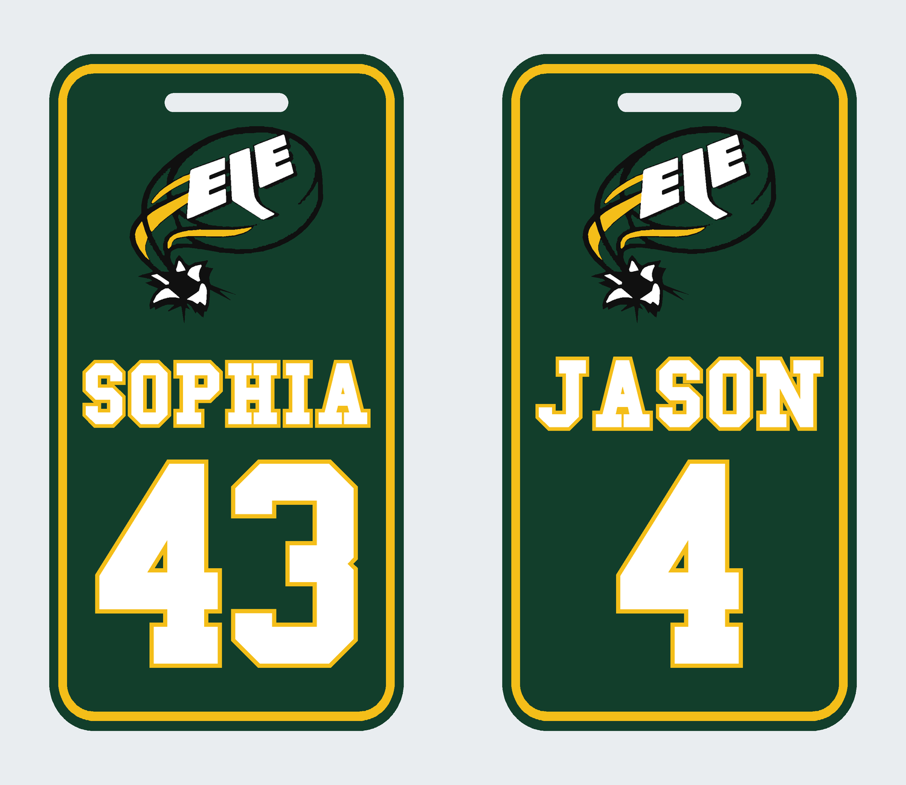

# EIE Hockey-Tag-Generator

Name und Nummer eingeben, Vorschau prüfen und eine mehrfarbige **3MF-Datei für Bambu Studio** herunterladen. Der Generator läuft lokal auf dem eigenen Computer.



## Starten

Benötigt werden **Python 3.11 oder neuer** und **Blender**. Die Referenzdateien wurden mit Blender 5.0.1 erzeugt und verglichen. Blender wird im Hintergrund für die Schrift verwendet; eine Bedienung von Blender ist nicht nötig.

- **Linux / macOS:** `bash start.sh` im Projektordner ausführen.
- **Windows:** `start.bat` doppelklicken. Python muss über den `py`-Launcher erreichbar sein.

Beim ersten Start installiert das Startprogramm die Python-Pakete in eine lokale `.venv`. Dafür ist eine Internetverbindung erforderlich. Anschliessend öffnet sich der Generator unter **http://127.0.0.1:8765**. Dieses Startfenster während der Benutzung geöffnet lassen; mit Strg+C beenden.

Blender wird über den Suchpfad, den üblichen macOS-Installationspfad oder unter Windows im Ordner „Blender Foundation“ gefunden. Bei einer anderen Installation die Umgebungsvariable `BLENDER_PATH` auf die ausführbare Blender-Datei setzen.

## Einen Tag erstellen

1. Name und ein- oder zweistellige Nummer eingeben.
2. **Tag erstellen & Vorschau anzeigen** wählen.
3. Vorschau prüfen und **3MF für Bambu Studio herunterladen** wählen.
4. Die Datei in Bambu Studio **als Projekt öffnen**, Filamente zuordnen und neu slicen.

Der Name wird in Grossbuchstaben gesetzt. Erlaubt sind A–Z, Leerzeichen, Bindestrich, Punkt und Apostroph, insgesamt bis zu 24 Zeichen. Umlaute werden zu AE/OE/UE, ß zu SS. Lange Namen werden proportional verkleinert; bei sehr kleiner Schrift erscheint ein Hinweis. Nummern von 0 bis 99 sind möglich; beispielsweise bleibt `04` zweistellig.

Die Vorschau wird aus denselben Dreiecken gerendert, die in der 3MF-Datei gespeichert werden. Eine Änderung der Eingaben blendet den alten Download aus, bis eine neue Datei erstellt wurde. Erzeugte Dateien bleiben zusätzlich im lokalen Ordner `generated/`; sie werden nicht von Git erfasst.

## Design und Druck

- Aussenmasse **55,88 × 106,68 mm**, maximale Gesamtdicke **3,96 mm**; entspricht der akzeptierten Originalgrösse.
- Vier Farben: Weiss, Grün, Gelb, Schwarz. Die konkrete grüne Filamentrolle ist noch nicht festgelegt.
- Name: **College Bold**. Nummer: **College**, mit den zusätzlichen Verbreiterungen der freigegebenen Version 4.
- Gelbe Kontur: 0,5 mm beim Namen, 0,6 mm bei der Nummer.
- Logo, Rahmen, Befestigungsschlitz, Basis und Druckausrichtung werden unverändert aus der Vorlage übernommen.
- Enthaltenes Druckprofil: **Bambu Lab A1, 0,4-mm-Düse, Generic PLA** für alle vier Farben. Die tatsächlichen Filamentprofile und Spülmengen vor dem Druck prüfen.

Name und Nummer werden im Generator geändert, nicht über das Textwerkzeug in Bambu Studio. Jeder Export enthält feste, farblich getrennte Geometrie. Die geometrischen Prüfungen ersetzen keinen Import-, Slicing- oder Probedrucktest in Bambu Studio.

## Entwicklung und Prüfung

```sh
python -m pip install -r requirements.txt
python -m tag_generator --name SOPHIA --number 43 --output generated
python -m tag_generator --no-browser
python -m unittest discover -s tests -v
```

Die Tests vergleichen beide freigegebenen v4-Tags mit frisch erzeugter Geometrie. Weitere Fälle prüfen lange Namen, führende Nullen, geschlossene Meshes, Ziffernöffnungen, Abstände, unveränderte Grundform und Druckprofile sowie Vorschau und Download über die lokale Anwendung.

### Projektstruktur

- `tag_generator/`: eigenständiger Generator, Browseroberfläche und freigegebene 3MF-Vorlage.
- `fonts/college/`: verwendete Schriftdateien und mitgelieferte Lizenz.
- `tests/`: Geometrie- und Anwendungstests.
- `output/`: bisherige Entwürfe und fertige Tag-Dateien; **v4_PLA** ist die freigegebene Gestaltung.
- `personalized/`, `typography/`, `logo/`, `build_tag.py`: Entstehungsschritte und frühere Hilfsskripte. Einzelne historische Skripte enthalten Pfade der ursprünglichen Arbeitsumgebung; der neue Generator benötigt sie nicht.
- `profiles/`: verwendete PLA-Profilgrundlagen.

## Herkunft und Rechte

Die mitgelieferten Schriftdateien stammen von **Matthew Welch**; die Original-Lizenz steht in [`fonts/college/license.txt`](fonts/college/license.txt).

Die 3MF-Grundlage ist die vom Nutzer bereitgestellte Datei *Hockey_Bag_Tag.3mf*. Deren Metadaten nennen **printme** als Designer und **MakerWorld Exclusive License** als Lizenz. Diese Angaben bleiben in der Vorlage und den Exporten erhalten. Das EIE-Logo wurde aus der bereitgestellten Fotovorlage rekonstruiert. Für diese fremden Gestaltungselemente wird hier keine zusätzliche Nutzungslizenz erteilt.
